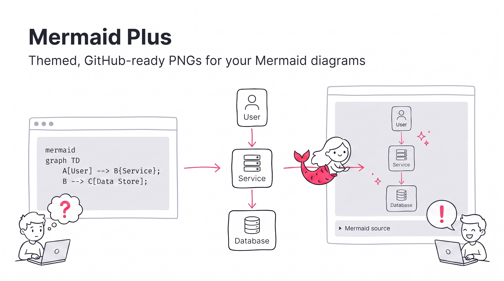
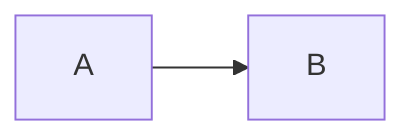

# gospelo-mermaid-plus

[](https://github.com/gospelo-dev/mermaid-plus/blob/main/LICENSE) [](https://www.python.org/) [](https://nodejs.org/) [-FF3670.svg?style=flat&logo=mermaid&logoColor=white)](https://github.com/gospelo-dev/mermaid-arch) [](https://docs.claude.com/en/docs/claude-code/skills)

<p align="center"></p>

Turn Mermaid diagrams in Markdown into **consistently themed, GitHub-ready PNGs**.

日本語版: [README_ja.md](https://github.com/gospelo-dev/mermaid-plus/blob/main/README_ja.md)

GitHub strips external fonts, `<style>` tags, and `data:` URIs from rendered Markdown, so Mermaid diagrams that rely on Font Awesome icons or custom styling look broken on github.com. This skill solves that with a two-step workflow:

1. **Apply a repository color scheme** to every Mermaid block (LLM-assisted)
2. **Render each block to PNG** and fold the original source into a collapsible `<details>` block

The result: crisp retina diagrams with working `fa:fa-*` icons, plus the editable Mermaid source kept right next to them.

New here? See the [Quickstart](https://github.com/gospelo-dev/mermaid-plus/blob/main/docs/QUICKSTART.md) ([日本語](https://github.com/gospelo-dev/mermaid-plus/blob/main/docs/QUICKSTART_ja.md)) for install and first-run steps with Claude Code or GitHub Copilot.

## Tools

Both tools are commands of one TypeScript CLI that Node.js runs directly (no build step). Rendering uses [`@gospelo/mermaid-arch`](https://github.com/gospelo-dev/mermaid-arch): Mermaid 12 with the ELK layout, AWS architecture icons, and Font Awesome Free 6.

### `apply-theme` — LLM-assisted theming

Extracts all ```` ```mermaid ```` blocks from a Markdown file and prints a self-contained prompt to stdout. Feed that prompt to an LLM (e.g. Claude) and it returns the same blocks with the repository color scheme applied — `classDef`, `linkStyle`, subgraph `style`, and `%%{init}` directives matching the palette in [references/color-scheme.md](https://github.com/gospelo-dev/mermaid-plus/blob/main/skills/claude/gospelo-mermaid-plus/references/color-scheme.md).

Why an LLM instead of regex? Correct Mermaid styling requires understanding diagram structure — which links are dashed vs. solid, which IDs are subgraphs, and 0-based `linkStyle` indices in declaration order. An LLM applies the theme semantically; a regex tool gets these wrong.

```bash
node skills/claude/gospelo-mermaid-plus/src/cli/main.ts apply-theme doc.md > /tmp/theme-prompt.md
# Feed the prompt to your LLM, then replace each mermaid block with the themed version
```

| Flag | Default | Description |
|---|---|---|
| `--scheme PATH` | `references/color-scheme.md` | Path to the color-scheme reference file |
| `--accent '#RRGGBB'` | none (default palette) | Custom accent color for solid links; the group border and node colors are derived from it using CIELAB color science |
| `--icons-zip ZIP` | none | AWS icon package zip. When blocks use `aws:` icons, the prompt lists each icon's AWS category color |

The default scheme: black links (solid = normal flow, dashed = read-only / monitoring — the meaning is in the line pattern, not the color), light periwinkle nodes (`#EEF2FF` / border `#A5B4FC`), and every subgraph drawn like an `architecture-beta` group — no fill and a light lavender dashed border (`#C7C7F1`). In diagrams with AWS icons, nodes stay white so the icon artwork carries the color.

With `--accent`, solid links take the color you pass, and the group border and the periwinkle node colors are derived from it in CIELAB (a perceptually uniform space): the accent's hue at the lightness and chroma of each default color, with the chroma reduced by binary search if the result falls outside sRGB. So every accent gives colors as light as the defaults. Dashed links, text and the white nodes of icon diagrams stay as they are. If the color has low contrast on white, the command warns on stderr and continues.

```bash
# Generate a theming prompt using your brand color
node skills/claude/gospelo-mermaid-plus/src/cli/main.ts apply-theme doc.md --accent '#1E90FF' > /tmp/theme-prompt.md
```

The command never modifies your file — the LLM's response is what gets applied.

### `mermaid2png` — PNG rendering with `<details>` fold

Finds every ```` ```mermaid ```` block, renders it to PNG with mermaid-arch (one headless browser for all blocks), saves the image to an `images/` directory next to the Markdown file, and rewrites each block in place as:

````markdown


<details><summary>Mermaid source</summary>



</details>
````

```bash
node skills/claude/gospelo-mermaid-plus/src/cli/main.ts mermaid2png doc.md --background white
```

| Flag | Default | Description |
|---|---|---|
| `--scale N` | `2` | PNG pixel ratio (2 = retina) |
| `--dry-run` | off | Report the planned output paths only; write nothing |
| `--icons-zip ZIP` | none | AWS icon package zip (`Icon-package_*.zip`); needed when blocks use `aws:` icons |
| `--chrome PATH` | auto | chrome-headless-shell executable |
| `--no-sandbox` | off | Start the browser with `--no-sandbox` (containers, root) |
| `--background COLOR` | `transparent` | PNG background: a CSS color or `transparent`. Use `white` for diagrams themed by `apply-theme` (their labels have white backgrounds, and they stay readable in GitHub's dark mode) |
| `--max-width PX` | none | Shrink diagrams wider than PX CSS pixels |

Flowcharts are laid out with ELK by default (Mermaid 12); set `layout: dagre` in a block's front matter to use dagre instead.

The command is **idempotent** — blocks that were already converted are skipped, so running it twice on the same file is safe. Blocks that fail to render are left untouched. To re-render a converted diagram (for example after editing its source inside `<details>`), delete its PNG and run the command again: the PNG is rendered back to the same path and the Markdown is not wrapped a second time.

## Prerequisites

Supported platforms: **macOS / Linux / WSL2**

| Dependency | Install |
|---|---|
| Node.js ≥ 22.18 | runs the TypeScript sources directly (type stripping) |
| npm dependencies | `npm ci --omit=dev` in the skill folder — `scripts/install.py` runs it |
| chrome-headless-shell | once: `npx @puppeteer/browsers install chrome-headless-shell@156.0.8078.47 --path ~/.cache/puppeteer` (`mermaid2png` prints the exact command when it is missing) |
| Python ≥ 3.9 | only for `scripts/install.py` (standard library only) |

## Usage example

```bash
CLI=skills/claude/gospelo-mermaid-plus/src/cli/main.ts

# 1. Generate the theming prompt and apply the color scheme via your LLM
node $CLI apply-theme docs/architecture.md > /tmp/theme-prompt.md

# 2. Render the themed blocks to PNG and fold the source into <details>
node $CLI mermaid2png docs/architecture.md --background white

# 3. Commit the rewritten Markdown and generated images
git add docs/architecture.md docs/images/
```

**AWS architecture diagrams** — flowcharts and `architecture-beta` with the official AWS Architecture Icons (`--icons-zip`): see the [AWS sample](https://github.com/gospelo-dev/mermaid-plus/blob/main/docs/examples/aws-architecture.md) for rendered diagrams, their Mermaid code, and how to get the icon package.

## Installing as an Agent Skill

This repository ships an [Agent Skill](https://docs.claude.com/en/docs/claude-code/skills) at `skills/claude/gospelo-mermaid-plus/`. The skill uses only the portable core of the open [Agent Skills standard](https://github.com/agentskills/agentskills), so it works with **Claude Code, GitHub Copilot, OpenAI Codex, and OpenCode**.

`scripts/install.py` copies (or symlinks) the skill into the discovery paths those agents scan — `.claude/skills/` and `.agents/skills/`:

```bash
git clone https://github.com/gospelo-dev/mermaid-plus.git
INSTALL=mermaid-plus/skills/claude/gospelo-mermaid-plus/scripts/install.py

# Into a project
python $INSTALL --project /path/to/repo

# User-wide (all projects on this machine)
python $INSTALL --user

# Development setup: symlink back to this clone instead of copying
python $INSTALL --user --symlink

# Replace an existing installation
python $INSTALL --project /path/to/repo --force
```

There is no OpenCode-specific copy of the skill and none is needed: OpenCode scans `.claude/skills/` and `.agents/skills/` natively, so the installer already covers it. OpenCode can also read the skills directly out of a clone through `skills.paths` in `opencode.json`, skipping the installer entirely — see the [Quickstart](https://github.com/gospelo-dev/mermaid-plus/blob/main/docs/QUICKSTART.md#opencode) for both the full list of scanned paths and that setup.

Agents discover the skill via [SKILL.md](https://github.com/gospelo-dev/mermaid-plus/blob/main/skills/claude/gospelo-mermaid-plus/SKILL.md) and trigger it when you say things like *"render mermaid to png"*, *"apply the color scheme"*, or *"make the FA icons show up on GitHub"*. See SKILL.md for the full workflow, the FA6 icon blacklist, and troubleshooting.

### Distributing as a ZIP

To hand the skill to someone without repo access:

```bash
cd mermaid-plus/skills/claude
zip -r gospelo-mermaid-plus.zip gospelo-mermaid-plus -x "*/node_modules/*" -x "*__pycache__*" -x "*.DS_Store"
```

The recipient unzips it anywhere and runs the installer (it also runs `npm ci`):

```bash
unzip gospelo-mermaid-plus.zip
python gospelo-mermaid-plus/scripts/install.py --project /path/to/repo   # or --user
```

## Companion skill: gospelo-md2backlog

Post the rendered result (Markdown + `images/`) to a [Backlog](https://backlog.com/) issue in one command. It uploads each local image via the Backlog API, rewrites references to Backlog's inline attachment syntax (`![image][name.png]`), and creates an issue or adds a comment:

```bash
# Per-repo config: <repo>/.backlog.env (gitignore it)
#   BACKLOG_SPACE_URL=https://yourspace.backlog.jp
#   BACKLOG_PROJECT=PJKEY
#   BACKLOG_API_KEY=...

python skills/claude/gospelo-md2backlog/scripts/md2backlog.py docs/design.md            # new issue
python skills/claude/gospelo-md2backlog/scripts/md2backlog.py docs/design.md --issue PJKEY-123  # comment
```

See [gospelo-md2backlog/SKILL.md](https://github.com/gospelo-dev/mermaid-plus/blob/main/skills/claude/gospelo-md2backlog/SKILL.md) for configuration and options. It installs the same way via its own `scripts/install.py`.

## Repository layout

```
mermaid-plus/
└── skills/
    └── claude/
        ├── gospelo-mermaid-plus/
        │   ├── SKILL.md            # Agent Skill definition and full documentation
        │   ├── src/
        │   │   ├── cli/main.ts     # CLI: apply-theme, mermaid2png
        │   │   ├── theme.ts        # Theming prompt generator
        │   │   ├── color.ts        # CIELAB accent derivation
        │   │   └── mermaid2png.ts  # Mermaid → PNG renderer (mermaid-arch)
        │   ├── tests/              # node --test (npm test)
        │   ├── vendor/             # mermaid-arch tarball (not on npm)
        │   ├── scripts/
        │   │   └── install.py      # Installer for agent skill discovery paths
        │   └── references/
        │       └── color-scheme.md # Full palette, icon recommendations, override policy
        └── gospelo-md2backlog/
            ├── SKILL.md            # Markdown + images → Backlog issue
            └── scripts/
                ├── md2backlog.py   # Attachment upload + inline rewrite + issue/comment
                └── install.py      # Installer (same as above)
```

## License

[MIT](https://github.com/gospelo-dev/mermaid-plus/blob/main/LICENSE)
