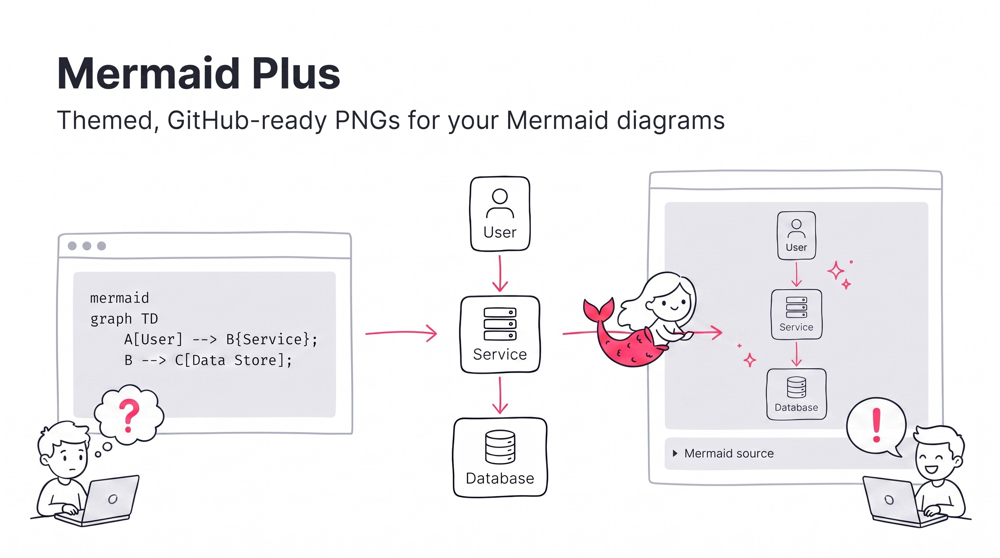
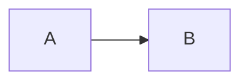

# gospelo-mermaid-plus

[](https://github.com/gospelo-dev/mermaid-plus/blob/main/LICENSE) [](https://www.python.org/) [](https://nodejs.org/) [-FF3670.svg?style=flat&logo=mermaid&logoColor=white)](https://github.com/gospelo-dev/mermaid-arch) [](https://docs.claude.com/en/docs/claude-code/skills)

<p align="center"></p>

Markdown 内の Mermaid 図を、**一貫したテーマ適用済み・GitHub 表示対応の PNG** に変換します。

English version: [README.md](https://github.com/gospelo-dev/mermaid-plus/blob/main/README.md)

GitHub は Markdown レンダリング時に外部フォント・`<style>` タグ・`data:` URI を除去するため、Font Awesome アイコンやカスタムスタイルを使った Mermaid 図は github.com 上で崩れて表示されます。このスキルは次の2段階のワークフローでこの問題を解決します:

1. **リポジトリのカラースキームを適用**(LLM 支援)— すべての Mermaid ブロックに統一テーマを当てる
2. **各ブロックを PNG にレンダリング**し、元の Mermaid ソースを折り畳み可能な `<details>` ブロックに格納する

結果として、`fa:fa-*` アイコンが正しく表示される高精細な図と、そのすぐ隣に編集可能な Mermaid ソースが残ります。

はじめての方は [クイックスタート](https://github.com/gospelo-dev/mermaid-plus/blob/main/docs/QUICKSTART_ja.md)([English](https://github.com/gospelo-dev/mermaid-plus/blob/main/docs/QUICKSTART.md))を参照してください。Claude Code / GitHub Copilot でのインストールと初回実行の手順があります。

## ツール

どちらのツールも、Node.js がそのまま実行する TypeScript の CLI のコマンドです(ビルド不要)。レンダリングには [`@gospelo/mermaid-arch`](https://github.com/gospelo-dev/mermaid-arch) を使います: Mermaid 12 と ELK レイアウト、AWS アーキテクチャアイコン、Font Awesome Free 6 に対応しています。

### `apply-theme` — LLM 支援によるテーマ適用

Markdown ファイルからすべての ```` ```mermaid ```` ブロックを抽出し、自己完結したプロンプトを標準出力に出力します。このプロンプトを LLM(Claude など)に渡すと、[references/color-scheme.md](https://github.com/gospelo-dev/mermaid-plus/blob/main/skills/claude/gospelo-mermaid-plus/references/color-scheme.md) のパレットに沿った `classDef`・`linkStyle`・subgraph `style`・`%%{init}` ディレクティブを適用済みの Mermaid コードが返ってきます。

正規表現ではなく LLM を使う理由: 正しい Mermaid スタイリングには図の構造理解が必要です — どのリンクが破線でどれが実線か、どの ID が subgraph か、宣言順 0 始まりの `linkStyle` 番号など。LLM は意味を踏まえてテーマを適用できますが、正規表現ツールはここを間違えます。

```bash
node skills/claude/gospelo-mermaid-plus/src/cli/main.ts apply-theme doc.md > /tmp/theme-prompt.md
# プロンプトを LLM に渡し、各 mermaid ブロックをテーマ適用済みコードに置き換える
```

| フラグ | デフォルト | 説明 |
|---|---|---|
| `--scheme PATH` | `references/color-scheme.md` | カラースキームのリファレンスファイルのパス |
| `--accent '#RRGGBB'` | なし(モノトーン) | 実線のリンクの色を指定。グループの枠線は、CIELAB 色空間でこの色から導出する |
| `--icons-zip ZIP` | なし | AWS アイコンパッケージの zip。ブロックが `aws:` アイコンを使うとき、各アイコンの AWS カテゴリ色をプロンプトに載せる |

既定のカラースキームはモノトーンに近いものです: リンクは黒(実線 = 通常の流れ、点線 = 読み取り専用・監視。意味は色ではなく線の種類で表す)、ノードは白、subgraph はどれも `architecture-beta` のグループと同じく、塗りなしで淡いラベンダーの点線の枠(`#C7C7F1`)です。色はアイコンとラベルが担います。

`--accent` を使うと、実線のリンクは指定した色になり、グループの枠線は CIELAB(知覚的に均等な色空間)でその色から導出されます: 指定した色の色相で、明度と彩度は既定の `#C7C7F1` と同じにし、sRGB の色域外なら二分探索で彩度を下げます。そのため、どの色を指定しても枠線は既定と同じくらい淡くなります。点線のリンクと文字は黒のままです。白背景でのコントラストが不足する色を渡した場合は stderr に警告が出ます(処理は継続します)。

```bash
# ブランドカラーでテーマ適用プロンプトを生成する
node skills/claude/gospelo-mermaid-plus/src/cli/main.ts apply-theme doc.md --accent '#1E90FF' > /tmp/theme-prompt.md
```

このコマンド自体はファイルを変更しません — 適用されるのは LLM の応答です。

### `mermaid2png` — PNG 化と `<details>` 折り畳み

すべての ```` ```mermaid ```` ブロックを見つけ、mermaid-arch で PNG にレンダリングし(全ブロックで1つのヘッドレスブラウザを使う)、Markdown ファイルと同じ場所の `images/` ディレクトリに保存した上で、各ブロックを次の形に書き換えます:

````markdown


<details><summary>Mermaid source</summary>



</details>
````

```bash
node skills/claude/gospelo-mermaid-plus/src/cli/main.ts mermaid2png doc.md --background white
```

| フラグ | デフォルト | 説明 |
|---|---|---|
| `--scale N` | `2` | PNG のピクセル比(2 = Retina) |
| `--dry-run` | オフ | 出力予定のパスを表示するだけで、何も書き込まない |
| `--icons-zip ZIP` | なし | AWS アイコンパッケージの zip(`Icon-package_*.zip`)。ブロックが `aws:` アイコンを使うときに必要 |
| `--chrome PATH` | 自動 | chrome-headless-shell の実行ファイル |
| `--no-sandbox` | オフ | ブラウザを `--no-sandbox` で起動する(コンテナ、root) |
| `--background COLOR` | `transparent` | PNG の背景: CSS の色または `transparent`。`apply-theme` でテーマを当てた図には `white` を使う(ラベルの背景が白で、GitHub のダークモードでも読める) |
| `--max-width PX` | なし | PX(CSS ピクセル)より幅の広い図を縮小する |

flowchart は既定で ELK でレイアウトされます(Mermaid 12)。dagre を使うときは、ブロックのフロントマターに `layout: dagre` を書きます。

このコマンドは**冪等**です — 変換済みのブロックはスキップされるため、同じファイルに2回実行しても安全です。レンダリングに失敗したブロックは元のまま残ります。変換済みの図を描画し直すとき(`<details>` の中のソースを直したときなど)は、その PNG を消してからもう一度実行します: PNG は同じパスに描画し直され、Markdown が二重に包まれることはありません。

## 前提条件

対応プラットフォーム: **macOS / Linux / WSL2**

| 依存 | インストール |
|---|---|
| Node.js 22.18 以上 | TypeScript のソースをそのまま実行する(型の除去) |
| npm の依存 | スキルのフォルダで `npm ci --omit=dev` — `scripts/install.py` が実行する |
| chrome-headless-shell | 一度だけ: `npx @puppeteer/browsers install chrome-headless-shell@156.0.8078.47 --path ~/.cache/puppeteer`(無いときは `mermaid2png` が正確なコマンドを表示する) |
| Python 3.9 以上 | `scripts/install.py` だけに使う(標準ライブラリのみ) |

## 使用例

```bash
CLI=skills/claude/gospelo-mermaid-plus/src/cli/main.ts

# 1. テーマ適用プロンプトを生成し、LLM 経由でカラースキームを適用する
node $CLI apply-theme docs/architecture.md > /tmp/theme-prompt.md

# 2. テーマ適用済みブロックを PNG 化し、ソースを <details> に折り畳む
node $CLI mermaid2png docs/architecture.md --background white

# 3. 書き換えられた Markdown と生成画像をコミットする
git add docs/architecture.md docs/images/
```

## Agent Skill としてのインストール

このリポジトリは `skills/claude/gospelo-mermaid-plus/` に [Agent Skill](https://docs.claude.com/en/docs/claude-code/skills) を同梱しています。オープンな [Agent Skills 標準](https://github.com/agentskills/agentskills)の可搬なコア部分のみを使用しているため、**Claude Code・GitHub Copilot・OpenAI Codex・OpenCode** で動作します。

`scripts/install.py` が、各エージェントの走査対象である `.claude/skills/` と `.agents/skills/` にスキルをコピー(またはシンボリックリンク)します:

```bash
git clone https://github.com/gospelo-dev/mermaid-plus.git
INSTALL=mermaid-plus/skills/claude/gospelo-mermaid-plus/scripts/install.py

# プロジェクトに導入
python $INSTALL --project /path/to/repo

# ユーザー全体に導入(このマシンの全プロジェクト)
python $INSTALL --user

# 開発向け: コピーではなくこの clone へのシンボリックリンクを張る
python $INSTALL --user --symlink

# 既存インストールを置き換え
python $INSTALL --project /path/to/repo --force
```

OpenCode 専用のスキルコピーは用意していませんし、必要もありません。OpenCode は `.claude/skills/` と `.agents/skills/` をネイティブに走査するため、上記のインストーラーだけで対応済みです。さらに `opencode.json` の `skills.paths` で clone を直接参照させれば、インストーラー自体を省略できます。走査パスの一覧とその設定方法は[クイックスタート](https://github.com/gospelo-dev/mermaid-plus/blob/main/docs/QUICKSTART_ja.md#opencode)を参照してください。

エージェントは [SKILL.md](https://github.com/gospelo-dev/mermaid-plus/blob/main/skills/claude/gospelo-mermaid-plus/SKILL.md) からスキルを発見し、「mermaid を PNG にして」「カラースキームを適用して」「GitHub で FA アイコンを表示したい」のような依頼で発火します。ワークフローの全体像・FA6 アイコンのブラックリスト・トラブルシューティングは SKILL.md を参照してください。

### ZIP での配布

リポジトリへのアクセス権がない相手に渡す場合:

```bash
cd mermaid-plus/skills/claude
zip -r gospelo-mermaid-plus.zip gospelo-mermaid-plus -x "*/node_modules/*" -x "*__pycache__*" -x "*.DS_Store"
```

受け取った側は任意の場所で unzip してインストーラーを実行します(`npm ci` も実行されます):

```bash
unzip gospelo-mermaid-plus.zip
python gospelo-mermaid-plus/scripts/install.py --project /path/to/repo   # または --user
```

## 姉妹スキル: gospelo-md2backlog

レンダリング結果(Markdown + `images/`)を [Backlog](https://backlog.com/) の課題に1コマンドで投稿します。ローカル画像を Backlog API でアップロードし、参照を Backlog のインライン添付記法(`![image][name.png]`)に書き換えて、課題の新規作成またはコメント追加を行います:

```bash
# リポジトリごとの設定: <repo>/.backlog.env (gitignore すること)
#   BACKLOG_SPACE_URL=https://yourspace.backlog.jp
#   BACKLOG_PROJECT=PJKEY
#   BACKLOG_API_KEY=...

python skills/claude/gospelo-md2backlog/scripts/md2backlog.py docs/design.md            # 課題を新規作成
python skills/claude/gospelo-md2backlog/scripts/md2backlog.py docs/design.md --issue PJKEY-123  # コメント追加
```

設定とオプションの詳細は [gospelo-md2backlog/SKILL.md](https://github.com/gospelo-dev/mermaid-plus/blob/main/skills/claude/gospelo-md2backlog/SKILL.md) を参照してください。インストールは同梱の `scripts/install.py` で同様に行えます。

## リポジトリ構成

```
mermaid-plus/
└── skills/
    └── claude/
        ├── gospelo-mermaid-plus/
        │   ├── SKILL.md            # Agent Skill 定義とドキュメント本体
        │   ├── src/
        │   │   ├── cli/main.ts     # CLI: apply-theme、mermaid2png
        │   │   ├── theme.ts        # テーマ適用プロンプト生成
        │   │   ├── color.ts        # CIELAB によるアクセント色の導出
        │   │   └── mermaid2png.ts  # Mermaid → PNG レンダラー(mermaid-arch)
        │   ├── tests/              # node --test(npm test)
        │   ├── vendor/             # mermaid-arch の tarball(npm 未公開)
        │   ├── scripts/
        │   │   └── install.py      # スキル発見パスへのインストーラー
        │   └── references/
        │       └── color-scheme.md # パレット全体・推奨アイコン・上書きポリシー
        └── gospelo-md2backlog/
            ├── SKILL.md            # Markdown + 画像 → Backlog 課題
            └── scripts/
                ├── md2backlog.py   # 添付アップロード+インライン書き換え+課題/コメント投稿
                └── install.py      # インストーラー(上と同じ)
```

## ライセンス

[MIT](https://github.com/gospelo-dev/mermaid-plus/blob/main/LICENSE)
