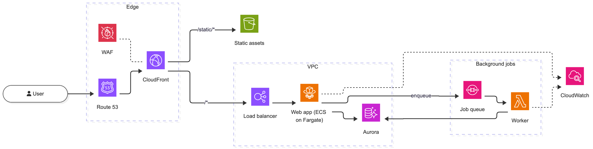
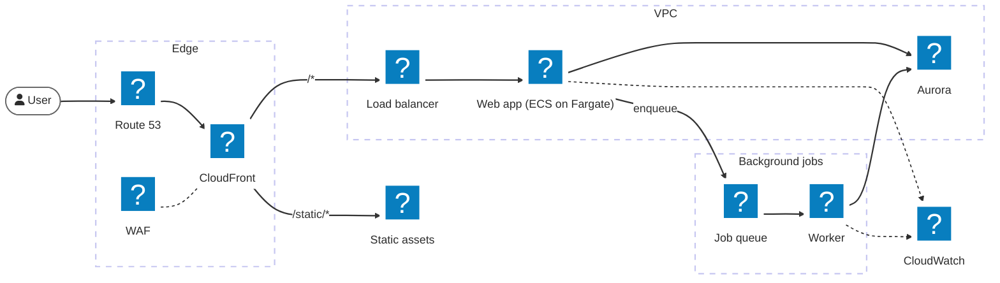
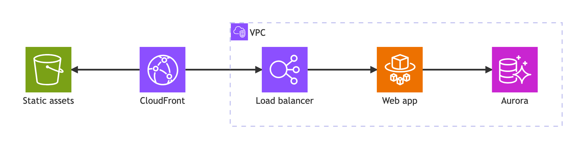

# Sample: AWS architecture diagrams

日本語版: [aws-architecture_ja.md](aws-architecture_ja.md)

gospelo-mermaid-plus draws AWS architecture diagrams with the official AWS Architecture Icons, using Mermaid 12 (ELK layout) through [`@gospelo/mermaid-arch`](https://github.com/gospelo-dev/mermaid-arch). GitHub's own Mermaid renderer has no AWS icons, so each diagram below is committed as a PNG, with its Mermaid source folded in `<details>` and shown again as code underneath.

## Get the AWS icon package

Download the Architecture Icons asset package (`Icon-package_*.zip`) from https://aws.amazon.com/architecture/icons/. The icons are AWS artwork: **do not commit or publish the zip** — publish the rendered diagrams, which is how AWS permits the icons to be used. Keep the zip outside the repository (or gitignore it).

List the icon names you can use (`Arch_Amazon-API-Gateway_48.svg` becomes `api-gateway`):

```bash
cd <skill-path> && npx mermaid-arch build-iconpack /path/to/Icon-package_*.zip --list
```

## Write, theme and render

```bash
CLI=<skill-path>/src/cli/main.ts
ZIP=/path/to/Icon-package_*.zip

# 1. Theme: the prompt adds the icon-node rules and each icon's AWS category color
node $CLI apply-theme docs/architecture.md --icons-zip $ZIP > /tmp/theme-prompt.md

# 2. Render to PNG; the icon zip is needed whenever a block uses aws: icons
node $CLI mermaid2png docs/architecture.md --icons-zip $ZIP --background white
```

`--background white` keeps the labels readable in GitHub's dark mode (the default PNG background is transparent).

Icons are written in two forms:

| Diagram | Form |
|---|---|
| `flowchart` | `id@{ icon: "aws:lambda", form: "square", label: "Worker", pos: "b" }` |
| `architecture-beta` | `service id(aws:lambda)[Worker]`, `group id(aws:virtual-private-cloud)[VPC]` |

A misspelled icon name stops the render with an `unknown-icon` error that suggests close matches.

## Flowchart with AWS icons

A web app behind CloudFront, with background jobs. Styled with the default color scheme: black links (solid for requests, dashed for protection and logging), groups drawn like `architecture-beta` groups (no fill, light dashed border), and the AWS icon artwork left as is. The dashed links come with `elk.lineHops: false` ([why](../skills/claude/gospelo-mermaid-plus/references/color-scheme.md#dashed-links-need-elklinehops-false)).



<details><summary>Mermaid source</summary>



</details>

Mermaid code:

````markdown

````

## architecture-beta

The same core in Mermaid's architecture diagram. Groups and services take `aws:` icons only (the built-in `(cloud)`, `(server)`, … icons are not available). `apply-theme` returns `architecture-beta` blocks unchanged.

```mermaid
architecture-beta
    group vpc(aws:virtual-private-cloud)[VPC]

    service cdn(aws:cloudfront)[CloudFront]
    service assets(aws:simple-storage-service)[Static assets]
    service alb(aws:elastic-load-balancing)[Load balancer] in vpc
    service app(aws:fargate)[Web app] in vpc
    service db(aws:aurora)[Aurora] in vpc

    cdn:R --> L:alb
    alb:R --> L:app
    app:R --> L:db
    cdn:L --> R:assets
```



<details><summary>Mermaid source</summary>



</details>

Mermaid code:

````markdown

````
