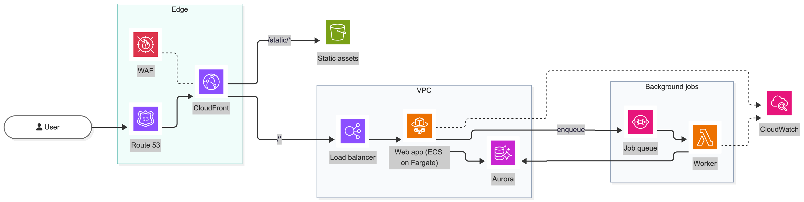
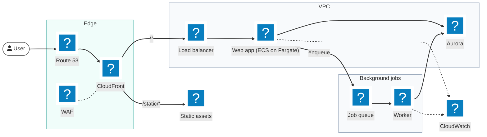
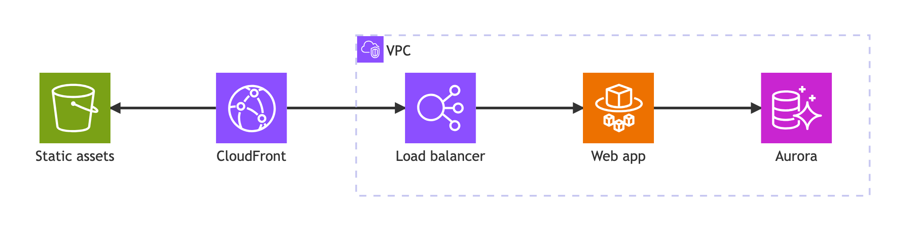

```mermaid
architecture-beta
    group vpc(aws:virtual-private-cloud)[VPC]

    service cdn(aws:cloudfront)[CloudFront]
    service assets(aws:simple-storage-service)[Static assets]
    service alb(aws:elastic-load-balancing)[Load balancer] in vpc
    service app(aws:fargate)[Web app] in vpc
    service db(aws:aurora)[Aurora] in vpc

    cdn:R --> L:alb
    alb:R --> L:app
    app:R --> L:db
    cdn:L --> R:assets
```

# サンプル: AWS 構成図

English: [aws-architecture.md](aws-architecture.md)

gospelo-mermaid-plus は、[`@gospelo/mermaid-arch`](https://github.com/gospelo-dev/mermaid-arch) を通して Mermaid 12(ELK レイアウト)で、AWS 公式の Architecture Icons を使った構成図を描けます。GitHub の Mermaid には AWS アイコンが無いため、下の図はどれも PNG としてコミットし、Mermaid のソースを `<details>` に折り畳んだうえで、その下にもコードとして載せています。

## AWS アイコンのパッケージを用意する

https://aws.amazon.com/architecture/icons/ から Architecture Icons のパッケージ(`Icon-package_*.zip`)をダウンロードします。アイコンは AWS の著作物です。**zip はコミットも公開もしないでください** — 公開するのは描画した図で、これが AWS の認めているアイコンの使い方です。zip はリポジトリの外に置くか、gitignore してください。

使えるアイコンの名前を一覧します(`Arch_Amazon-API-Gateway_48.svg` は `api-gateway` になります):

```bash
cd <skill-path> && npx mermaid-arch build-iconpack /path/to/Icon-package_*.zip --list
```

## 書く、テーマを当てる、描画する

```bash
CLI=<skill-path>/src/cli/main.ts
ZIP=/path/to/Icon-package_*.zip

# 1. テーマ: プロンプトに、アイコンのノードのルールと各アイコンの AWS カテゴリ色が入る
node $CLI apply-theme docs/architecture.md --icons-zip $ZIP > /tmp/theme-prompt.md

# 2. PNG に描画する。aws: アイコンを使うブロックがあれば、アイコンの zip が必要
node $CLI mermaid2png docs/architecture.md --icons-zip $ZIP --background white
```

`--background white` を付けると、GitHub のダークモードでもラベルが読めます(PNG の背景は既定では透明です)。

アイコンの書き方は2通りです:

| 図 | 書き方 |
|---|---|
| `flowchart` | `id@{ icon: "aws:lambda", form: "square", label: "Worker", pos: "b" }` |
| `architecture-beta` | `service id(aws:lambda)[Worker]`、`group id(aws:virtual-private-cloud)[VPC]` |

アイコンの名前を間違えると、描画は `unknown-icon` のエラーで止まり、近い名前を提案します。

## AWS アイコンを使った flowchart

CloudFront の後ろにある Web アプリと、バックグラウンドのジョブです。線は AWS の構成図と同じく黒にしています: リクエストは実線、保護とログは点線です。subgraph の背景はリポジトリのカラースキームの淡い色で、AWS のアイコンの絵はそのままです。点線があるので `elk.lineHops: false` を付けています([理由](../skills/claude/gospelo-mermaid-plus/references/color-scheme.md#dashed-links-need-elklinehops-false))。



<details><summary>Mermaid source</summary>


</details>

Mermaid のコード:

````markdown

````

## architecture-beta

同じ構成の中心部分を、Mermaid の architecture 図で描いたものです。group と service に使えるのは `aws:` のアイコンだけです(組み込みの `(cloud)`、`(server)` などは使えません)。`apply-theme` は `architecture-beta` のブロックを変更せずに返します。



<details><summary>Mermaid source</summary>



</details>

Mermaid のコード:

````markdown

````
