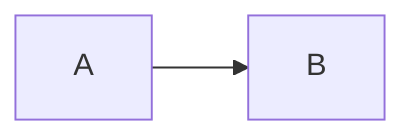

# Mermaid → PNG Skill

This skill provides two commands for working with Mermaid diagrams in
Markdown, both run by one CLI:

1. **`apply-theme`** — Generate an LLM prompt that applies the repository
   color scheme to mermaid blocks
2. **`mermaid2png`** — Render mermaid blocks to PNG images and fold the
   source into `<details>`

Typical workflow: apply the theme first, then render to PNG.

```bash
node <skill-path>/src/cli/main.ts apply-theme <markdown_file> [options]
node <skill-path>/src/cli/main.ts mermaid2png <markdown_file> [options]
```

The CLI is TypeScript that Node (≥ 22.18) runs directly — there is no build
step. Rendering is done by
[`@gospelo/mermaid-arch`](https://github.com/gospelo-dev/mermaid-arch)
(Mermaid 12, ELK layout, AWS icons, Font Awesome Free 6), bundled in
`vendor/`. See [Prerequisites](#prerequisites) for the one-time setup.

---

## Tool 1: Apply Color Scheme (`apply-theme`)

Extracts all `` ```mermaid `` blocks from a Markdown file and prints a
self-contained prompt to stdout. Feed this prompt to the LLM so it returns
properly themed Mermaid code — with `classDef`, `linkStyle`, subgraph
`style`, and `%%{init}` directives matching the repository palette.

### Why use an LLM for theming

Mermaid styling requires understanding diagram structure: which nodes exist,
which links are dashed vs solid, which subgraphs are primary vs auxiliary.
A regex-based tool can get the basics wrong (mis-counted linkStyle indices,
missed node IDs inside subgraphs, etc.).  By generating a prompt with the
full color-scheme reference and the raw blocks, the LLM can apply the theme
intelligently — respecting semantic meaning (dashed = non-destructive path)
and handling edge cases.

### Usage

```bash
# Generate the prompt
node <skill-path>/src/cli/main.ts apply-theme doc.md > /tmp/theme-prompt.md

# Then feed the prompt content to the LLM conversation
```

In practice, as an Agent Skill, the workflow is:

1. Run `apply-theme <file>` to capture the prompt
2. Process the prompt (the LLM applies the color scheme)
3. Replace each mermaid block in the file with the themed version
   (each block header in the prompt gives its fence lines in the file)
4. Optionally run `mermaid2png` to render to PNG

### Options

| Flag | Default | Description |
|---|---|---|
| `--scheme PATH` | `references/color-scheme.md` | Path to color-scheme reference file |
| `--accent '#RRGGBB'` | (none — uses default teal) | Custom accent color. Auto-generates a complete color scheme from a single hex color using CIELAB color science. Replaces the default teal accent and derives a light tint for subgraph fills. Warns on stderr if the color has low contrast on white. |
| `--icons-zip ZIP` | (none) | AWS icon package zip. When blocks use `aws:` icons, the prompt lists each icon's AWS category color. |

### Color scheme summary

The full reference is in `references/color-scheme.md`.  Key values:

**Palette:**

| Role | Value |
|---|---|
| Node fill / stroke / text | `#FFFFFF` / `#666666` (1.5 px) / `#2C2C2C` |
| Accent link (solid) | `#0D9488` (2 px) — normal data/control flow (override with `--accent`) |
| Dashed link (grey) | `#9CA3AF` (1.5 px, `4 4`) — read-only / monitoring |
| Primary subgraph | fill `#F0FDFA` / stroke `#0D9488` (auto-derived from `--accent`) |
| Neutral subgraph | fill `#F8FAFC` / stroke `#94A3B8` |

**Rules:**

- `classDef node` applied to ALL nodes in a flowchart
- Solid accent-color links for normal flow (`-->`), dashed grey for non-destructive (`-.->`)
- `linkStyle` indices are declaration-order, 0-based — always verify after editing
- sequenceDiagram uses `%%{init: {'theme':'base', 'themeVariables': {...}}}%%`
- `fa:fa-*` icons in flowchart node labels only (not in sequenceDiagram)
- The scheme sets no font. If a diagram must set `themeVariables.fontFamily`
  in `%%{init}%%`, use a single name without commas or quotes (`Inter`):
  Mermaid silently drops values like `'IBM Plex Sans', sans-serif` there
- Override the palette when the user explicitly requests different colors or
  when semantic color-coding is needed (≤ 4–5 colors)

**Icon nodes** (the prompt adds these rules only when blocks use `aws:`
icons or are `architecture-beta`):

- Never recolor AWS icon artwork. A `classDef` may cover icon nodes, but
  their `fill` must be unset or very light (it shows as a plate behind the
  icon); `stroke` has no effect on them.
- `architecture-beta` blocks are returned unchanged; only `aws:` icons are
  available there (no built-in `(cloud)`, `(server)`, ... group icons).
- Flowcharts are laid out with ELK by default; avoid dagre-only styling.

Read `references/color-scheme.md` for the full palette mapping, recommended
icons, blacklist, and override policy.

---

## Tool 2: Render to PNG (`mermaid2png`)

Finds every `` ```mermaid `` block in a Markdown file, renders it to PNG,
and rewrites the file so the rendered image appears inline with the
original source tucked into a collapsible `<details>` block.

### Why this exists

GitHub strips external fonts, `<style>`, `@font-face`, `<svg>`, and `data:`
URIs from Markdown, and its own Mermaid renderer has no AWS icons.  The only
reliable way to show icon-rich Mermaid diagrams on GitHub is to commit
pre-rendered PNGs.

### What it produces

For `doc.md` with two mermaid blocks:

```
doc.md              ← rewritten in place
images/
  doc-1.png         ← rendered from block 1
  doc-2.png         ← rendered from block 2
```

(A file with a single block gets `images/doc.png`.)  Each original block
becomes:

````markdown


<details><summary>Mermaid source</summary>



</details>
````

### Usage

```bash
node <skill-path>/src/cli/main.ts mermaid2png <markdown_file>

# with AWS icons (aws:lambda, ...)
node <skill-path>/src/cli/main.ts mermaid2png doc.md --icons-zip ~/Downloads/Icon-package_*.zip
```

### Options

| Flag | Default | Description |
|---|---|---|
| `--scale N` | `2` | PNG pixel ratio (1 = 1×, 2 = retina) |
| `--dry-run` | off | Report block count and planned paths only; renders nothing and leaves the Markdown untouched |
| `--icons-zip ZIP` | (none) | AWS Architecture Icons zip (`Icon-package_*.zip`); required when blocks use `aws:` icons |
| `--chrome PATH` | auto | chrome-headless-shell executable (default: `$CHROME_PATH`, `$PUPPETEER_EXECUTABLE_PATH`, then puppeteer's cache) |
| `--no-sandbox` | off | Start the browser with `--no-sandbox` (containers, running as root) |
| `--background COLOR` | `transparent` | PNG background: a CSS color or `transparent` |
| `--max-width PX` | (none) | Shrink diagrams wider than PX CSS px |

Exit codes: `0` success, `1` error (file not found, unclosed mermaid block,
browser missing), `2` usage error.  A block that fails to render (e.g. a
Mermaid syntax error) is reported on stderr and left unchanged; the other
blocks are still converted.

### Idempotency

A block is skipped only when it sits in the exact `![diagram]` + `<details>`
fold this tool writes **and** the referenced PNG exists on disk. If the
PNG is missing (e.g. it was deleted, or a wrapper was left behind without a
render), the PNG is rendered again to the path the fold references and the
Markdown is left as it is — the block is not wrapped a second time. Running
twice on the same file is safe; when every block is converted, no browser
is started.

To re-render a converted diagram (after editing its source in the fold, or
to pick up a newer Mermaid), delete its PNG and run `mermaid2png` again.

### Icons

- **Font Awesome** — `fa:fa-*` (and `fab:fa-*`) in labels are drawn with
  the bundled Font Awesome Free 6.7.2. No network access is needed.
- **AWS** — flowchart `id@{ icon: "aws:lambda", label: "..." }` and
  architecture-beta `service id(aws:lambda)[...]`. The AWS icon package is
  not bundled: download it from
  <https://aws.amazon.com/architecture/icons/> and pass `--icons-zip`.
  Commit only the rendered PNGs, never the icon package.

When publishing images with Font Awesome icons, credit Font Awesome
(CC BY 4.0) — see `THIRD_PARTY_NOTICES.md`.

---

## Prerequisites

| Dependency | Install |
|---|---|
| Node.js ≥ 22.18 | runs `src/*.ts` directly (type stripping) |
| npm dependencies | `npm ci --omit=dev` in the skill folder — `scripts/install.py` runs it |
| chrome-headless-shell | once: `npx @puppeteer/browsers install chrome-headless-shell@156.0.8078.47 --path ~/.cache/puppeteer` |

The browser version must be the one mermaid-arch's puppeteer-core expects;
when it is missing, `mermaid2png` stops and prints the exact install
command.  `apply-theme` needs no browser.

Install the skill into a project (copies this folder, then runs `npm ci`):

```bash
python <skill-path>/scripts/install.py --project /path/to/repo
```

---

## FA6 Icon Blacklist

26 icon names exist in the FA npm package but have **no glyph in the FA6
Free Solid font** — they silently render as blank:

`alarm-clock` `aquarius` `aries` `bus-side` `cancer` `capricorn`
`closed-captioning-slash` `gemini` `hexagon` `leo` `libra`
`mobile-vibrate` `non-binary` `octagon` `pentagon` `picture-in-picture`
`pisces` `sagittarius` `scorpio` `septagon` `single-quote-left`
`single-quote-right` `spiral` `taurus` `virgo` `volume`

All other FA6 Free Solid icons work with `fa:fa-*`.

## Troubleshooting

- **`chrome-missing`** — Install chrome-headless-shell with the command
  printed in the error (see Prerequisites), or pass `--chrome`.
- **Browser fails to start in a container / as root** — add `--no-sandbox`.
- **`Cannot find package '@gospelo/mermaid-arch'`** — run
  `npm ci --omit=dev` in the skill folder.
- **`ERR_UNKNOWN_FILE_EXTENSION` (Unknown file extension ".ts")** — Node is
  older than 22.18 and cannot run TypeScript directly; upgrade Node.
- **`icons-zip-missing` / `unknown-icon`** — the block uses `aws:` icons:
  pass `--icons-zip`, and check the icon name (the error suggests close
  matches).
- **Icons blank in PNG** — Check the blacklist above; stick to FA6 Free Solid.
- **Block skipped ("already converted")** — Delete the block's PNG and re-run;
  it is rendered again in place.
